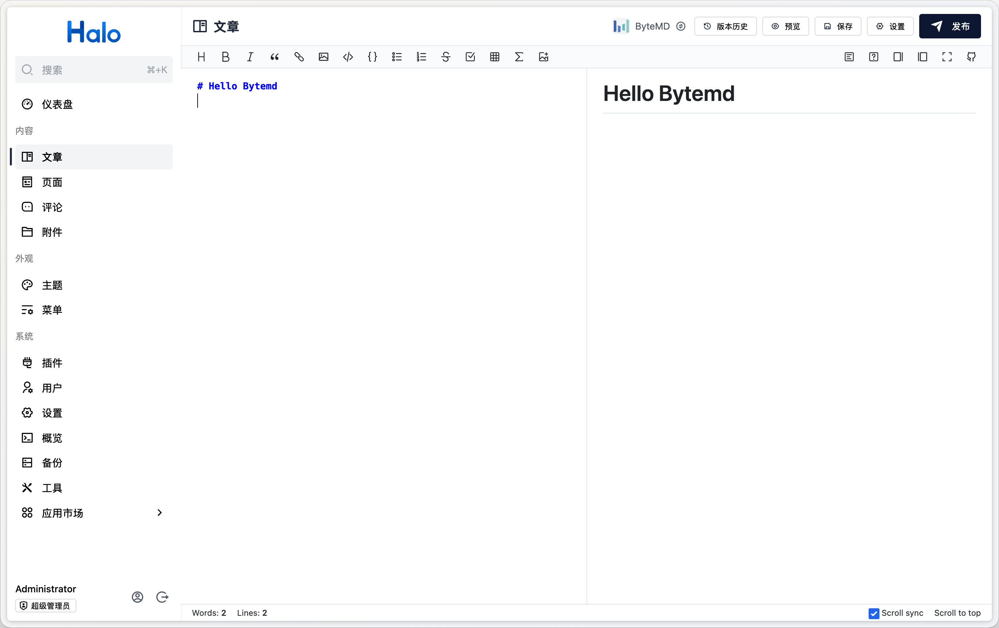

# plugin-bytemd

集成 [bytemd](https://github.com/bytedance/bytemd) 到 Halo。



## 使用方式

1. 下载，目前提供以下两个下载方式：
    - GitHub Releases：访问 [Releases](https://github.com/halo-sigs/plugin-bytemd/releases) 下载 Assets 中的 JAR 文件。
    - Halo 应用市场：<https://www.halo.run/store/apps/app-HTyhC>。
2. 安装，插件安装和更新方式可参考：<https://docs.halo.run/user-guide/plugins>。
3. 安装完成之后，进入文章新建页面即可在右上角编辑器切换按钮中看到 ByteMD 编辑器。

## 常见问题

1. 如何支持编写数学公式

目前此插件已经支持编写数学公式，但需要同时安装 [plugin-katex](https://github.com/halo-sigs/plugin-katex) 插件才能够正常在编辑器预览区域渲染。另外，还需要在 KaTeX 插件设置中设置 dom 节点才能够在文章中正常渲染，可以参考：<https://github.com/halo-sigs/plugin-katex#%E6%96%87%E7%AB%A0%E9%A1%B5%E6%B8%B2%E6%9F%93%E5%85%AC%E5%BC%8F>

## HTML 内联样式

插件默认使用 ByteMD 的 HTML 清洗规则，HTML 标签可以混排，但 `style` 属性会被移除。
如需保留颜色、间距、Flex 布局等内联 CSS，可在插件的「基础设置」中开启「允许 HTML 内联样式」，然后重新打开编辑器。
编辑器预览与保存的 HTML 使用相同规则；已有文章需要重新保存才能更新生成的 HTML，关闭选项也不会自动修改已保存的文章。

此选项仅适用于受信任的作者，作用于所有使用 ByteMD 的作者。CSS 本身不经过清洗，可能影响页面布局或加载外部资源。
脚本、事件属性、危险链接及其他标签的过滤规则仍然保留；此选项不会开放 `iframe`、`script` 或 `style` 标签。

## 开发环境

```bash
git clone git@github.com:halo-sigs/plugin-bytemd.git

# 或者当你 fork 之后

git clone git@github.com:{your_github_id}/plugin-bytemd.git
```

```bash
cd path/to/plugin-bytemd
```

```bash
# 需要 Docker 环境

# macOS / Linux
./gradlew haloServer

# Windows
./gradlew.bat haloServer
```
